<div align="center">

# 🍽️ QR Menü

**Restoranlar için tak‑çalıştır dijital menü.**
Zip'i cPanel'e at, aç, `install.php`'yi çalıştır — 5 dakikada QR menün hazır.


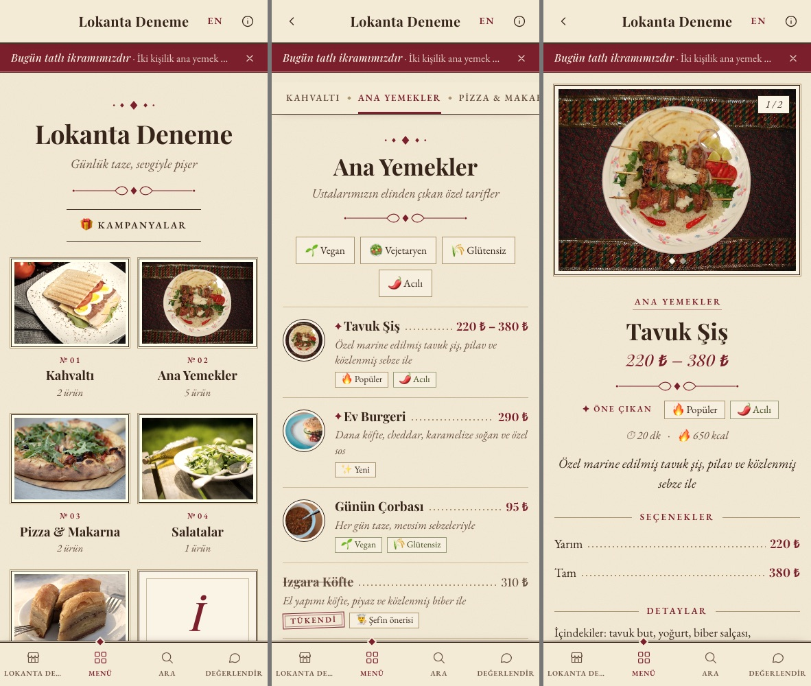

</div>

---

> **English summary** — QR Menü is a self‑hosted digital restaurant menu written in plain PHP with a single SQLite file. No framework, no Composer, no Node, no MySQL: upload the folder to any shared host (cPanel), open `install.php`, pick a name and a password, and you are done. Guests scan a QR code and get a fast mobile menu with photos, portion prices, allergens, Turkish/English text, campaigns and ratings. Owners manage everything from a simple admin panel: drag‑and‑drop ordering, six switchable themes, statistics, QR generator and one‑click backup/restore. Turkish UI; the rest of this README is in Turkish.

---

## İçindekiler

- [Neden bu proje?](#neden-bu-proje)
- [Özellikler](#özellikler)
- [Temalar](#temalar)
- [Kurulum (5 dakika)](#kurulum-5-dakika)
- [Kullanım](#kullanım)
- [Yönetim paneli](#yönetim-paneli)
- [Teknik ayrıntılar](#teknik-ayrıntılar)
- [Güvenlik](#güvenlik)
- [Katkı ve lisans](#katkı-ve-lisans)

---

## Neden bu proje?

Çoğu dijital menü ya aylık abonelik ister ya da kurmak için sunucu, veritabanı ve komut satırı bilgisi gerektirir. Bu projenin tek bir hedefi var:

> **Bilgisayardan anlamayan bir restoran sahibi, ucuz bir paylaşımlı hostingte, kimseye sormadan kendi QR menüsünü kurabilsin.**

Bu yüzden teknoloji seçimleri bilerek "sıkıcı" tutuldu:

| Seçim | Neden |
|---|---|
| **Saf PHP (7.4+)** | Dünyadaki hemen her paylaşımlı hostingte hazır çalışır. Kurulacak bir şey yok. |
| **SQLite** | Veritabanı tek bir dosya (`data/menu.db`). MySQL hesabı açmak, kullanıcı/şifre girmek yok. Yedek almak = dosyayı kopyalamak. |
| **Framework, Composer, Node yok** | Derleme adımı yok, `vendor/` klasörü yok, sürüm çakışması yok. Zip'i açtığın an site çalışır. |
| **Tek klasör** | Her şey tek klasörde. Taşımak, kopyalamak, silmek kolay. |
| **Tarayıcıdan kurulum** | `install.php` gereksinimleri kontrol eder, veritabanını kurar, örnek menü ekler, sonra kendini kilitler. |

Kısacası: **sürükle‑bırak, tak‑çalıştır.** cPanel'de "Upload" ve "Extract" düğmelerini bulabiliyorsan kurabilirsin.

---

## Özellikler

### Müşteri tarafı (telefon)

- **Hızlı, hafif menü** — tek sayfalık PHP, dış servis yok, telefonda anında açılır.
- **Kategoriler ve ürünler** — kapak fotoğrafı, birden fazla ürün fotoğrafı (kaydırmalı galeri), açıklama ve detaylar.
- **Seçenekler / porsiyonlar** — "Yarım 220 ₺ · Tam 380 ₺" gibi fiyatlı seçenekler; listede otomatik fiyat aralığı.
- **Rozetler** — Öne çıkan, Yeni, Popüler, Acılı, Şefin önerisi, **Tükendi** (üstü çizili, soluk).
- **Alerjen ve diyet bilgisi** — gluten, süt, fındık… + Vegan / Vejetaryen / Glütensiz filtreleri.
- **Kalori ve hazırlık süresi** alanları.
- **Arama** — Türkçe karakterlere duyarsız ("ızgara", "IZGARA", "izgara" aynı sonucu verir).
- **Türkçe / İngilizce** — tek dokunuşla dil değişimi; ürün, kategori, açıklama ve sabit metinler çevrilir.
- **Kampanyalar** — sayfa açılışında popup ya da üst band olarak; tarih aralığı ile otomatik başlar/biter.
- **Restoran puanı** — 5 kriter (Lezzet, Sunum, Servis, Temizlik, Fiyat/Performans) ve yorum.
- **Ürün puanı** — her ürünün altından 5 yıldız üzerinden tek puan + isteğe bağlı kısa yorum.
- **Bilgi sayfası** — logo, slogan, **Şu an açık / kapalı** göstergesi, Wi‑Fi şifresi (kopyala düğmesi), Ara, Yol tarifi, WhatsApp, Instagram, çalışma saatleri.
- **KVKK / aydınlatma metni** ve işletmenin kendi notları (KDV, servis ücreti vb.).
- **Fiyatları gizle** seçeneği (fiyatsız vitrin menü).

<div align="center">
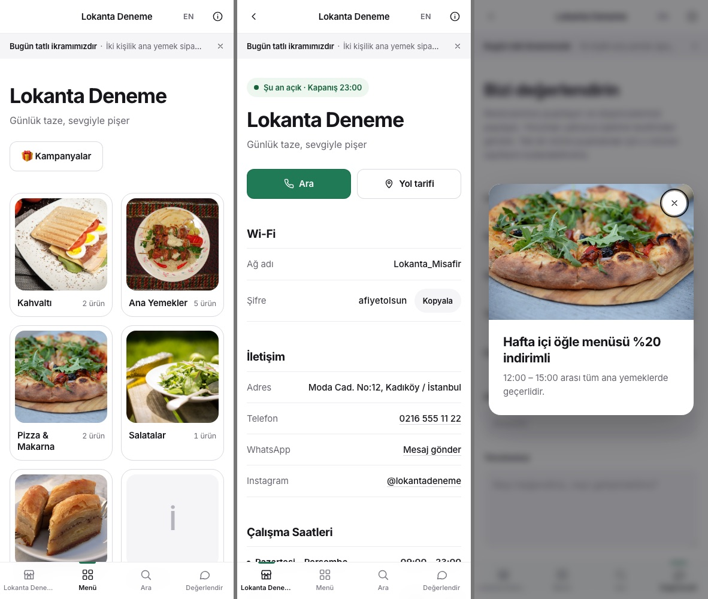
<br><sub>Kampanya popup'ı · Bilgi sayfası · Restoran değerlendirme formu</sub>
</div>

### Yönetim paneli (bilgisayar / tablet)

- **Tek sayfa menü yönetimi** — kategori kartları → ürün listesi; ekleme/düzenleme açılır pencerede.
- **Sürükle‑bırak sıralama** — kategori ve ürünleri tutup taşı, kaydetmeye gerek yok.
- **Fotoğraf yönetimi** — birden fazla fotoğraf, kapak seçimi, sıralama; yüklenen her resim yeniden boyutlandırılır ve yeniden kodlanır.
- **Kampanyalar** — popup veya band, başlangıç/bitiş tarihi, görsel.
- **Yorumlar ve puanlar** — restoran yorumları (okundu işareti, silme), ürün puanları listesi, kriter ortalamaları.
- **İstatistik** — günlük ziyaretçi, sayfa görüntüleme, en çok bakılan ürünler ve kategoriler.
- **QR kod** — menü adresi için QR üret, PNG/SVG indir, yazdır.
- **Tema** — 6 hazır tema, tek tıkla değişir, anında önizleme.
- **Yedek** — tüm veri + resimler tek zip; kurulum ekranından geri yükleme.
- **Şifre sıfırlama** — paneli açamıyorsan `data/reset.key` dosyasıyla şifreni yenile (ürünler korunur).

<div align="center">
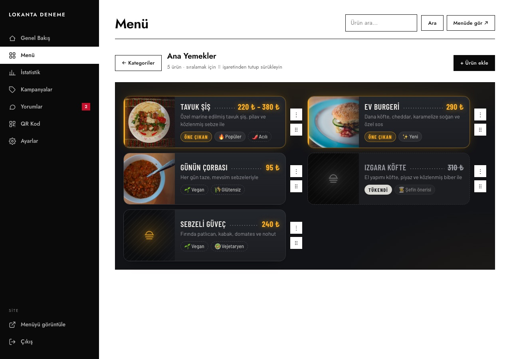
<br><sub>Menü yönetimi — ürünler kartlar halinde, ⋮ menüsünden düzenle / tükendi / sil</sub>
</div>

---

## Temalar

Tema, **Ayarlar → Tema** sekmesinden tek tıkla seçilir. Her tema aynı içeriği tamamen farklı bir karakterle sunar; yayına almadan `?tema=dark` gibi bir parametreyle önizleyebilirsin.

| Tema | Karakter |
|---|---|
| **Clean** | Sade, ferah ve nötr. Beyaz zemin ve bol boşlukla tasarım geri planda kalır, ürünler öne çıkar. |
| **Dark** | Loş ortamlar için koyu zemin, açık metin ve karanlıkta parlayan tek bir vurgu rengi (renk seçilebilir). |
| **Klasik** | Basılı restoran menüsünün dijital karşılığı: krem kâğıt, serif başlıklar, noktalı fiyat çizgileri. |
| **Bauhaus** | Grafik ve cesur: beyaz, siyah ve kırmızı; keskin köşeli bloklar ve güçlü bir ızgara. |
| **Canlı** | Renkli, yuvarlak ve oyunbaz: pastel kategoriler, çıkartma kartlar, yaylanan hareketler. |
| **Art Deco** | 1920'lerin lüks ve simetrik dili: zümrüt zemin, altın çizgiler, yelpaze ve basamak motifleri. |

### Clean
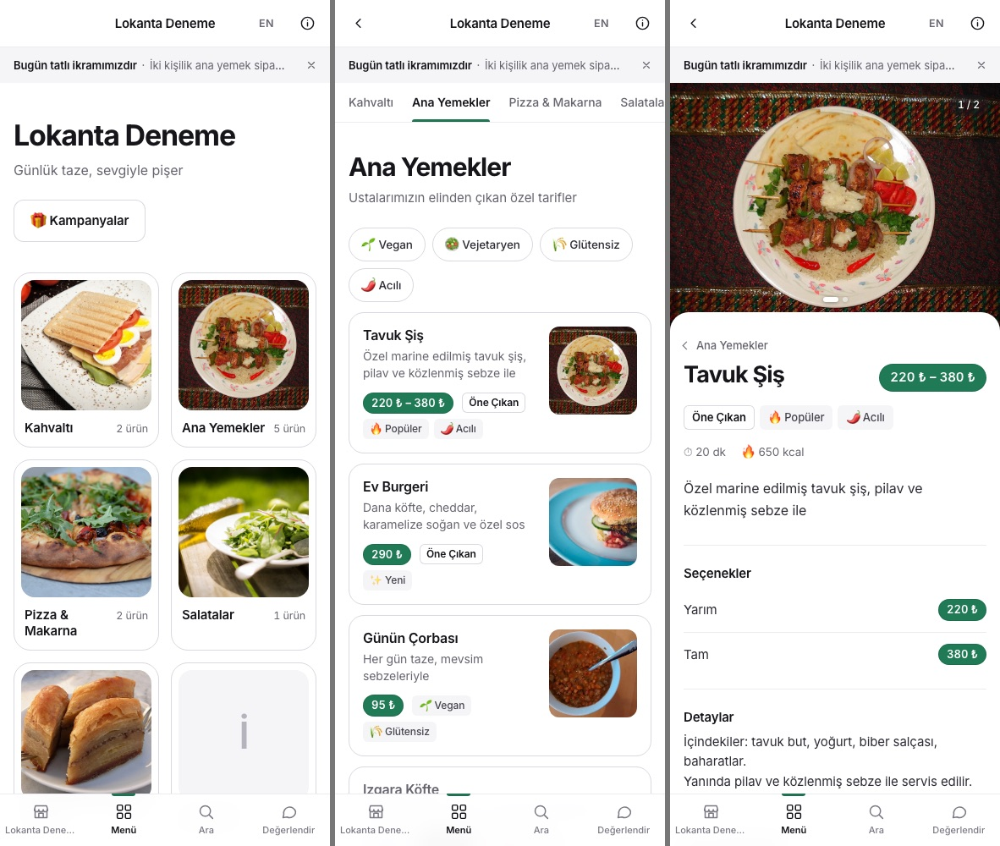

### Dark
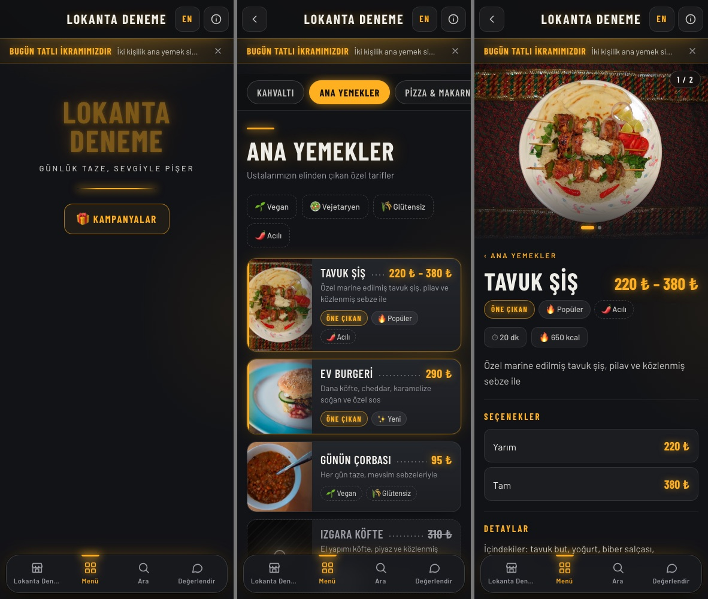

### Klasik


### Bauhaus
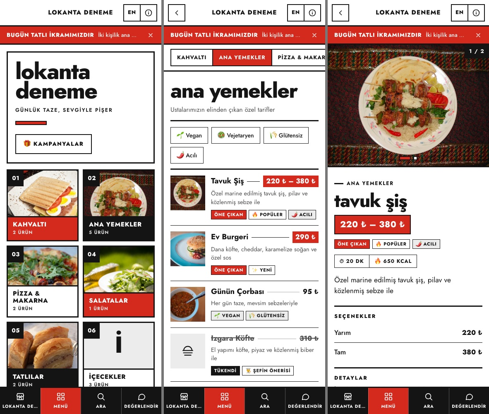

### Canlı
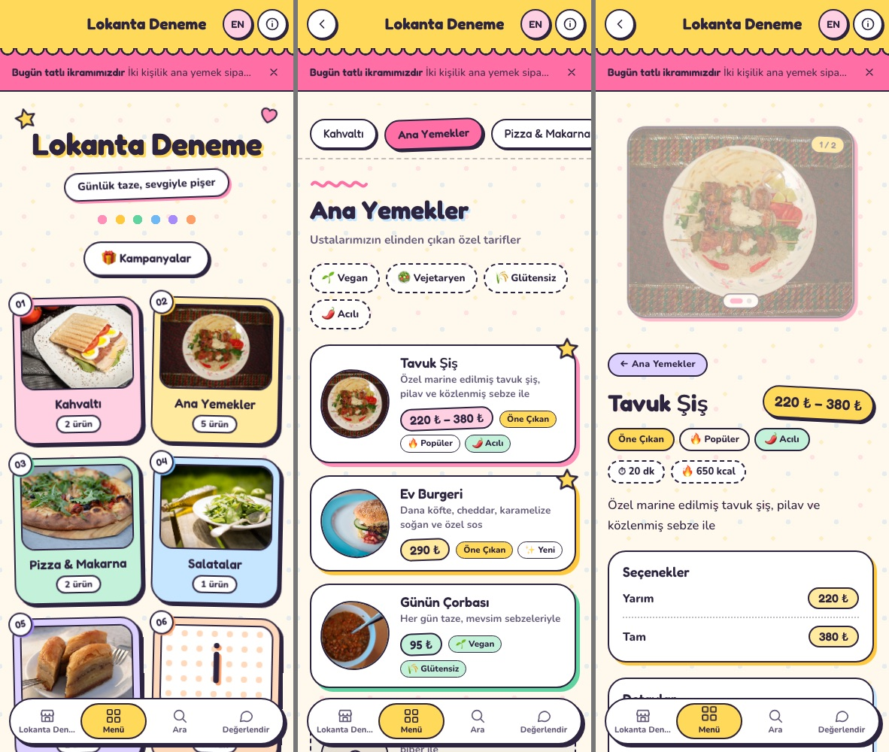

### Art Deco
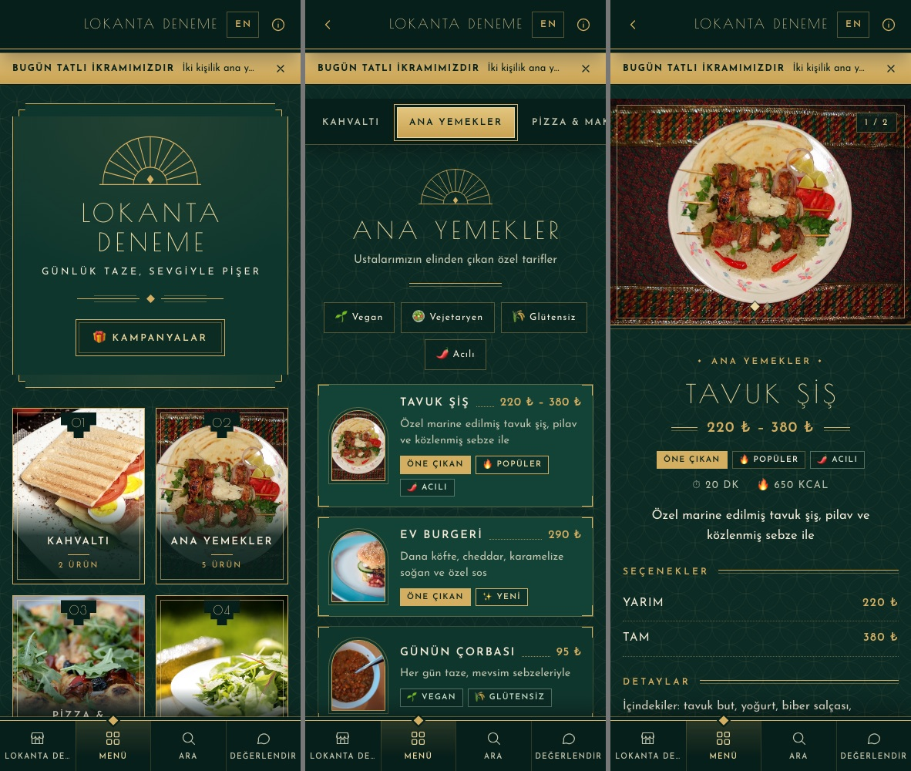

<div align="center">
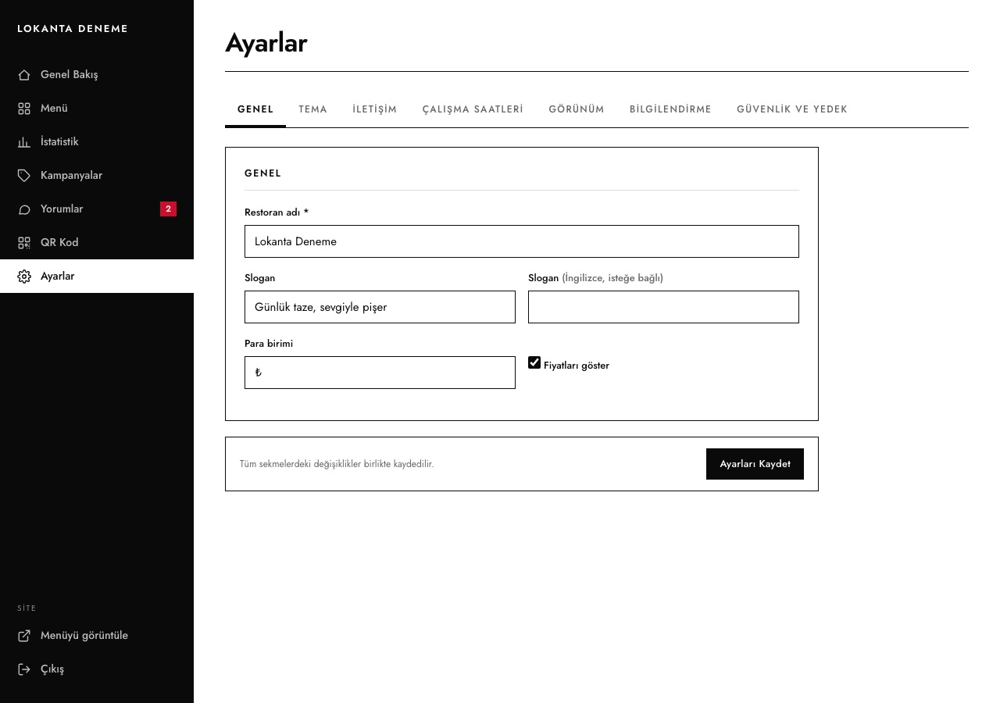
<br><sub>Ayarlar → Tema: kartlardan birini seç, kaydet.</sub>
</div>

---

## Kurulum (5 dakika)

### Gereksinimler

Hemen her cPanel hostingte varsayılan olarak hazırdır; `install.php` zaten hepsini kontrol edip eksik varsa söyler.

| Gereksinim | Not |
|---|---|
| PHP 7.4 veya üzeri | 8.x önerilir |
| `pdo_sqlite` | veritabanı |
| `gd` | resim küçültme |
| `fileinfo` | yükleme güvenliği |
| `zip` | yalnızca yedek al / geri yükle için |
| `data/` ve `uploads/` yazılabilir | genelde 755 yeterli |

### cPanel ile adım adım

1. Bu depoyu **Code → Download ZIP** ile indir.
2. cPanel → **Dosya Yöneticisi** → `public_html` (ya da `menu` gibi bir alt klasör) → **Upload** → zip'i yükle.
3. Zip'e sağ tıkla → **Extract**. Açılan klasörün içeriği doğrudan `public_html` içinde olmalı (`index.php` orada görünmeli).
4. Dosya Yöneticisi'nde **Settings → Show Hidden Files (dotfiles)** işaretli olsun ve `.htaccess` dosyalarının geldiğini kontrol et. Bu dosyalar `data/` klasörünü dışarıdan erişime kapatır.
5. Tarayıcıda **`https://siteadi.com/install.php`** adresini aç.
6. Restoran adını ve bir yönetici şifresi gir. "Örnek ürünler eklensin" işaretli kalırsa hazır bir menüyle başlarsın (sonradan silebilirsin).
7. Bitti. **`/admin/`** yönetim paneli, **`/`** müşteri menüsü.

> Ayrıntılı, ekran ekran anlatım ve sorun giderme için **[KURULUM.txt](KURULUM.txt)** dosyasına bak.

### Yerel bilgisayarda deneme

```bash
git clone https://github.com/ahmetkadiraktas/qr-menu.git
cd qr-menu
php -S localhost:8080
# tarayıcı: http://localhost:8080/install.php
```

---

## Kullanım

| İş | Nerede |
|---|---|
| Menüyü doldur | Admin → **Menü** → Kategori ekle → kategoriye gir → Ürün ekle |
| Sıralamayı değiştir | Kartların köşesindeki ⠿ tutamacından sürükle |
| Ürünü tükendi yap | Ürün kartında ⋮ → **Tükendi olarak işaretle** (aynı yerden geri al) |
| Tema seç | Admin → **Ayarlar → Tema** |
| Telefon, adres, Wi‑Fi, Instagram | Admin → **Ayarlar → İletişim** |
| Çalışma saatleri | Admin → **Ayarlar → Çalışma Saatleri** |
| Bilgi notları, KVKK metni | Admin → **Ayarlar → Bilgilendirme** |
| Logo ve arka plan görseli | Admin → **Ayarlar → Görünüm** |
| Restoran adı, slogan, fiyatları gizle | Admin → **Ayarlar → Genel** |
| İngilizce metinler | Her ürün/kategoride **EN** sütunu; sabit metinler için Ayarlar'da EN alanları |
| Kampanya | Admin → **Kampanyalar** → Yeni (popup veya band, tarih aralığı) |
| QR kodu bas | Admin → **QR Kod** → PNG/SVG indir ya da yazdır |
| Yedek al / şifre değiştir | Admin → **Ayarlar → Güvenlik ve Yedek** |
| Yorumları oku | Admin → **Yorumlar** (okunmamış sayısı menüde görünür) |

---

## Yönetim paneli

<div align="center">
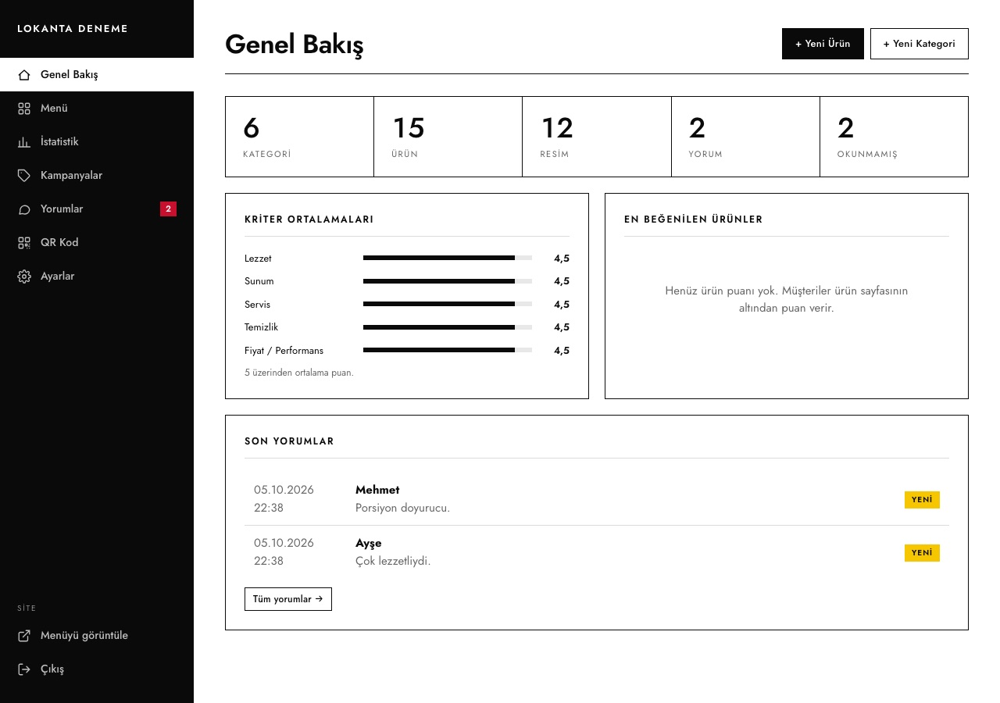
<br><sub>Genel Bakış — kriter ortalamaları, en beğenilen ürünler, son yorumlar</sub>
<br><br>
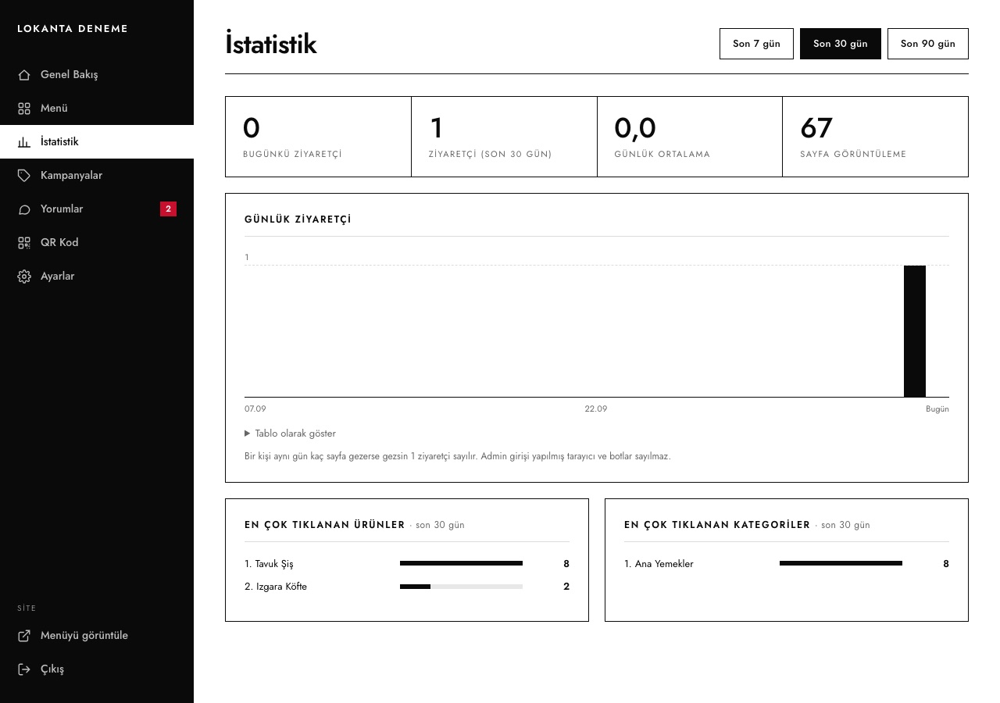
<br><sub>İstatistik — günlük ziyaretçi grafiği, en çok görüntülenen ürün ve kategoriler</sub>
<br><br>
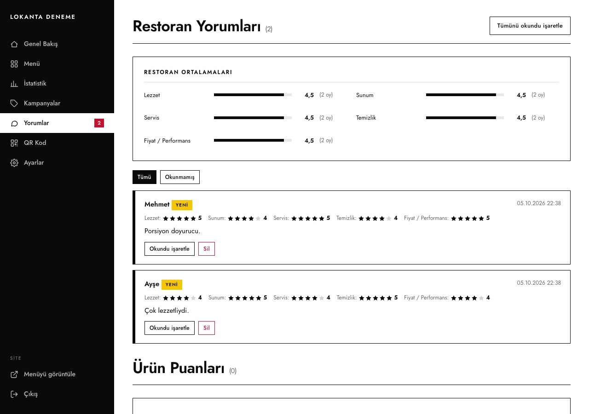
<br><sub>Yorumlar — restoran yorumları ve ürün puanları tek sayfada</sub>
<br><br>
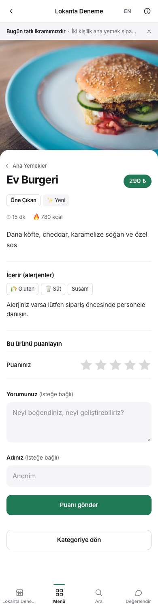
<br><sub>Müşteri tarafında her ürünün altındaki puan kutusu</sub>
</div>

---

## Teknik ayrıntılar

```
qr-menu/
├── index.php            Ana sayfa (kategoriler, öne çıkanlar)
├── kategori.php         Kategori ürün listesi
├── urun.php             Ürün sayfası + ürün puanı formu
├── ara.php              Arama
├── degerlendirme.php    Restoran değerlendirme formu
├── bilgi.php, yasal.php Bilgi sayfası, KVKK metni
├── install.php          Kurulum / yedekten kurulum / şifre sıfırlama
├── admin/               Yönetim paneli (menu, kampanyalar, yorumlar, istatistik, qr, ayarlar, yedek)
├── inc/                 Ortak kod: db, auth, functions, lang, themes, queries, partial'lar
├── assets/
│   ├── css/menu-base.css   Müşteri tarafı yapısal CSS (temadan bağımsız)
│   ├── css/themes/*.css    Her tema tek dosya
│   ├── css/admin.css       Panel
│   └── js/                 app.js, admin.js + gömülü Sortable (sürükle-bırak) ve qrcode (QR üretimi)
├── data/                menu.db (SQLite), oturumlar — dışarıya kapalı
└── uploads/             Yüklenen resimler (products/, categories/, campaigns/, site/)
```

- **Veritabanı şeması** `inc/db.php` içinde; `DB_SCHEMA_VERSION` artırılıp `db_migrate()`'e adım eklenerek güncellenir. Eski bir kurulum yeni dosyalarla ilk açıldığında kendiliğinden geçiş yapar.
- **Güncelleme:** yeni sürümün dosyalarını eskilerin üzerine yaz; `data/` ve `uploads/` klasörlerine dokunma.
- **Tema yazmak:** `assets/css/themes/` içine yeni bir CSS dosyası koy ve dosyanın başına
  `/* @theme fonts: ...; theme-color: #...; accents: ... */` satırını ekle; `inc/themes.php`'de ad ve açıklamasını tanımla. Yapısal stiller `menu-base.css`'te, tema yalnızca görünümü değiştirir.
- **Diller:** `inc/lang.php` içindeki TR → EN sözlüğü; `t()` ile çağrılır.
- Harici servis, CDN veya izleme kodu yok; JS kütüphaneleri (Sortable, qrcode) depoda gömülü. Tek dış istek: temanın başlığında yazı tipi tanımlıysa Google Fonts.

---

## Güvenlik

- Tüm formlarda CSRF belirteci; tüm çıktılar kaçışlı (`e()`).
- `data/` ve `inc/` klasörleri `.htaccess` ile dışarıya kapalı; `install.php` bunu kendisi test eder ve açık kalmışsa kurulumu durdurur.
- Yönetici girişi: 5 hatalı denemede 15 dk kilit, genel deneme sınırı, 12 saat hareketsizlikte oturum düşer, şifre değişince eski oturumlar geçersizleşir.
- Yorum ve puanlarda bal tuzağı, cihaz çerezi ve IP bazlı oran sınırı (ortak Wi‑Fi'ye toleranslı), saatlik genel sınır.
- Yüklenen resimler GD ile yeniden kodlanır (EXIF ve gömülü içerik atılır), uzantı/MIME doğrulanır.
- Yedek geri yüklemede zip içeriği beyaz listeyle süzülür; boyut ve dosya sayısı sınırlıdır.
- Veritabanı dosyasında yönetici şifresinin yalnızca hash'i tutulur; yedeklerde şifre bulunmaz.

Bir açık bulursan lütfen herkese açık issue yerine önce e‑posta ile bildir: **ahmetkadiraktas7@gmail.com**

---

## Katkı ve lisans

Hata bildirimi ve öneriler için **Issues**, düzeltmeler için **Pull Request** açabilirsin. Tasarım felsefesi basit: *kurulumu zorlaştıran hiçbir bağımlılık eklenmez.*

[MIT Lisansı](LICENSE) — dilediğin gibi kullan, değiştir, kendi restoranında ya da müşterilerin için yayınla.

---

## İletişim

Görüş, öneri ya da kurulumda destek için: **[ahmetkadiraktas7@gmail.com](mailto:ahmetkadiraktas7@gmail.com)**
